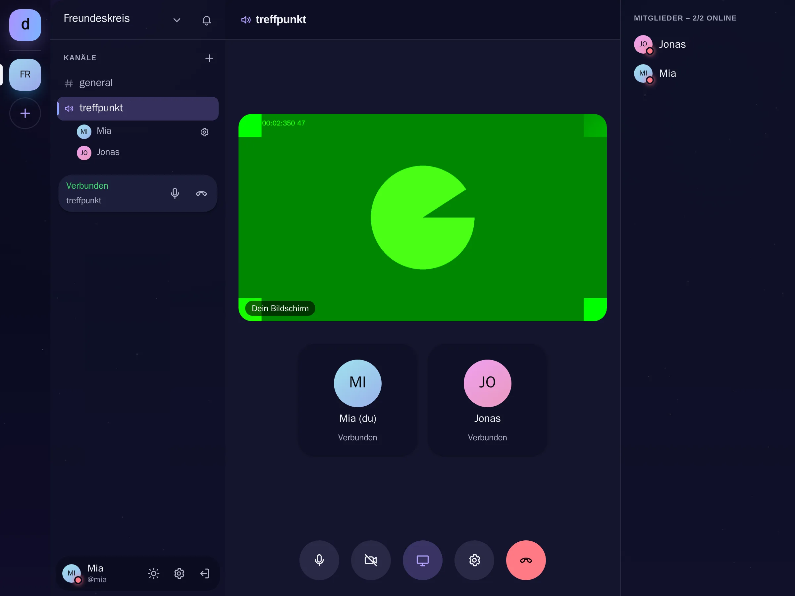

# Bildschirm teilen

[Alle Funktionen](README.md)

Bildschirm, Fenster oder Tab in Sprachkanal und Anruf zeigen.

## Ansicht

Hell: [bildschirm-hell.webp](../../sites/hilfe/bilder/bildschirm-hell.webp). Die Bilder macht `e2e/tests/hilfe-bilder.spec.ts`.

## Bedienung

- Bildschirm-Knopf im Anruf, Auswahl im Browser.
- Andere sehen ihn groß, mit Vollbild-Knopf.
- Nochmal tippen oder „Freigabe beenden“ im Browser stoppt.

## Regeln und Grenzen

- Nur am Computer, Handy-Browser können das nicht.
- Pro Person ein Bild: Der Bildschirm ersetzt die Kamera und gibt sie danach zurück.
- Kein Ton vom Bildschirm.
- 15 Bilder/s, bis 1080p, höchstens 1,5 Mbit/s pro Verbindung. Über TURN zählt das aufs Monatslimit.

## Technik

- `VoiceClient.setScreen`, `getDisplayMedia`, `contentHint = detail`
- `voice.video` mit `screen`, `VoicePeerDto.screen`, auch beim Nachkommen
- `ScreenStage` in `CallTiles.tsx`
- `display-capture=(self)` in `deploy/Caddyfile`

## Tests

- `backend/test/voice-channels.test.ts`
- `frontend/src/__tests__/voiceClient.test.tsx`
- `e2e/tests/screen-share.spec.ts` mit echter WebRTC-Übertragung
