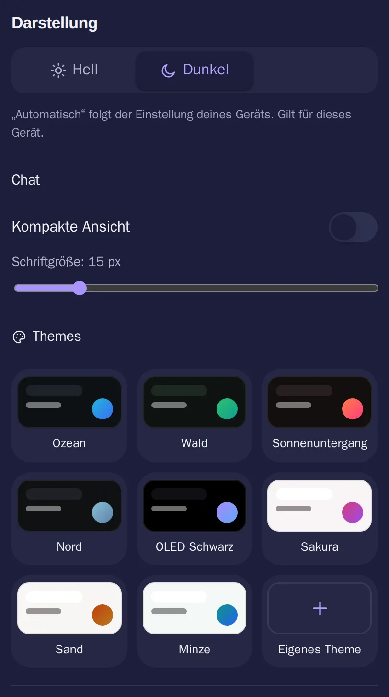

# Darstellung

[Alle Funktionen](README.md)

Farben, Dichte und Schriftgröße im slxt-Design, Standard dunkel.

## Ansicht

Hell: [darstellung-hell.webp](../../sites/hilfe/bilder/darstellung-hell.webp). Die Bilder macht `e2e/tests/hilfe-bilder.spec.ts`.

## Bedienung

- Sonne oder Mond unten neben den Einstellungen wechselt zwischen hell und dunkel.
- Einstellungen → Darstellung: hell, dunkel, Themes, eigenes Theme.
- Chat: kompakte Ansicht, Schriftgröße.

## Regeln und Grenzen

- Gilt pro Gerät. Die Systemeinstellung wird nicht befolgt, wie auf allen slxt-Seiten.

## Technik

- `frontend/src/theme/themes.ts`, `store/prefs.ts`, `components/AppearanceSettings.tsx`, `components/Himmel.tsx`

## Tests

- `frontend/src/__tests__/theme.test.tsx`, `themes.test.ts`
- `e2e/tests/theme.spec.ts`
