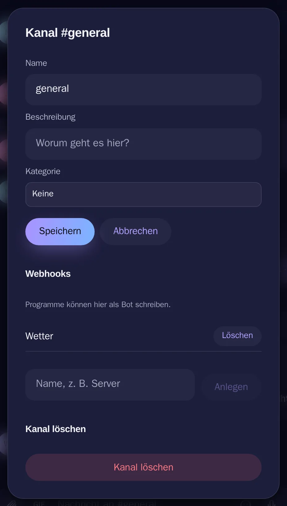

# Kanäle und Kategorien

[Alle Funktionen](README.md)

Kanäle anlegen, ordnen, umbenennen und löschen.

## Ansicht

Hell: [kanaele-hell.webp](../../sites/hilfe/bilder/kanaele-hell.webp). Die Bilder macht `e2e/tests/hilfe-bilder.spec.ts`.

## Bedienung

- Plus neben „Kanäle“ legt einen an, Text oder Sprache.
- Zahnrad am Kanal: Name, Beschreibung, Kategorie, Löschen.
- Rollen & Mitglieder → Kanäle: Kategorien, sortieren per Ziehen oder Pfeilen.
- Tipp auf eine Kategorie klappt sie zu.

## Regeln und Grenzen

- Alles braucht `manage_channels`.
- Löschen braucht den Namen und nimmt Nachrichten und Dateien mit.
- Der letzte offene Textkanal bleibt.
- Oberster Textkanal: Einstieg und Begrüßung. Höchstens 30 Kategorien.

## Technik

- `backend/src/services/channel.service.ts`
- `PATCH/DELETE /api/channels/:id`, `PUT /api/guilds/:id/channels/order`, `/api/guilds/:id/categories`
- Event `guild.channels-changed` nur mit Server-ID, verrät nichts über verborgene Kanäle
- `components/ChannelSettingsDialog.tsx`, `ChannelOrganizer.tsx`

## Tests

- `backend/test/channel-management.test.ts`, `channels.test.ts`
- `e2e/tests/channels.spec.ts`
