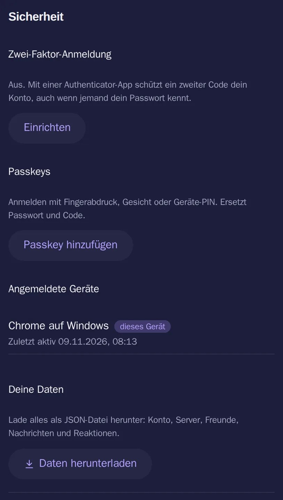

# Passkeys

[Alle Funktionen](README.md)

Anmelden mit Fingerabdruck, Gesicht oder Geräte-PIN.

## Ansicht

Hell: [sicherheit-hell.webp](../../sites/hilfe/bilder/sicherheit-hell.webp). Die Bilder macht `e2e/tests/hilfe-bilder.spec.ts`.

## Bedienung

- Einstellungen → Sicherheit → Passkey hinzufügen: Name, Passwort, Gerät bestätigen.
- Anmeldeseite: Mit Passkey anmelden.
- Entfernen in derselben Liste.

## Regeln und Grenzen

- Ersetzt Passwort und Zwei-Faktor-Code, das Gerät prüft die Person (`userVerification: required`).
- Bis zu 10 pro Konto. Hinzufügen braucht das Passwort.
- Eine Anfrage gilt 5 Minuten und nur einmal.
- Das Passwort bleibt als Rückweg bestehen.

## Technik

- `backend/src/services/passkey.service.ts` mit `@simplewebauthn/server`, Browser mit `@simplewebauthn/browser`
- Tabellen `passkeys`, `passkey_challenges`, nur öffentliche Schlüssel
- `POST /api/auth/passkey/options`, `POST /api/auth/passkey`, `/api/account/passkeys`
- `rpID` ist der Hostname aus `PUBLIC_URL`

## Tests

- `backend/test/security-account.test.ts`
- `e2e/tests/account-security.spec.ts` mit virtuellem Authenticator
- Noch nicht mit echtem Handy getestet
