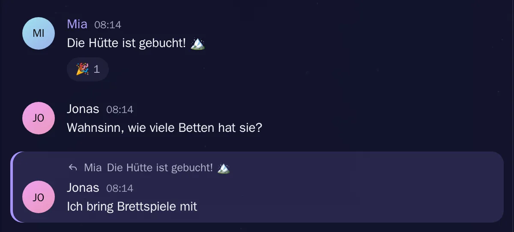

# Reaktionen

[Alle Funktionen](README.md)

Emoji unter Nachrichten, sichtbar für alle im Kanal.

## Ansicht

Hell: [reaktionen-hell.webp](../../sites/hilfe/bilder/reaktionen-hell.webp). Die Bilder macht `e2e/tests/hilfe-bilder.spec.ts`.

## Bedienung

- Smiley an der Nachricht, sechs Emoji direkt oder alle über die Suche.
- Auf eine vorhandene Reaktion tippen macht mit, noch einmal nimmt sie weg.

## Regeln und Grenzen

- Höchstens 20 verschiedene Emoji pro Nachricht.
- Nur echte Emoji, Prüfung in `shared/src/schemas.ts`.
- Auf Begrüßungen kann man nicht reagieren.

## Technik

- `POST /api/messages/:id/reactions` schaltet um
- Event `message.reactions`
- Tabelle `message_reactions`
- Auswahl als Portal am Bildschirm, die Nachrichtenliste würde sie sonst abschneiden

## Tests

- `backend/test/chat-features.test.ts`
- `e2e/tests/chat-features.spec.ts`
