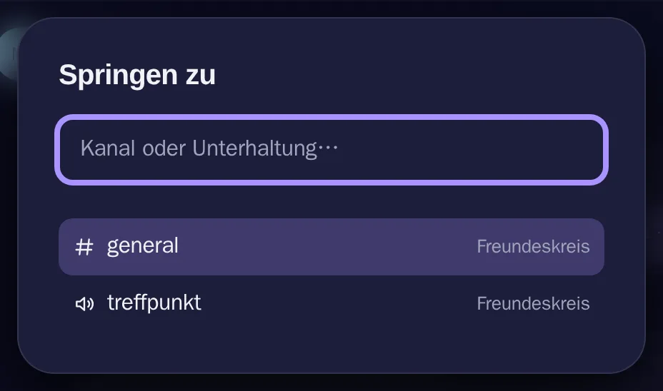

# Schnellwechsler

[Alle Funktionen](README.md)

Mit Strg+K per Name zu Kanal oder Unterhaltung springen.

## Ansicht

Hell: [springen-hell.webp](../../sites/hilfe/bilder/springen-hell.webp). Die Bilder macht `e2e/tests/hilfe-bilder.spec.ts`.

## Bedienung

- `Strg+K`, tippen, `Enter`.

## Regeln und Grenzen

- Ohne Eingabe steht Ungelesenes oben. Verborgene Kanäle erscheinen nicht.

## Technik

- `components/QuickSwitcher.tsx`

## Tests

- `frontend/src/__tests__/chatFeatures.test.tsx`
- `e2e/tests/polls-switcher.spec.ts`
