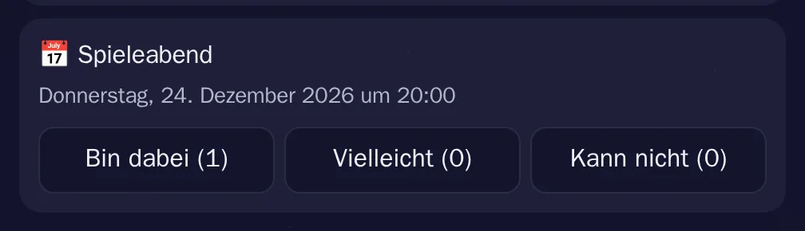

# Termine

[Alle Funktionen](README.md)

Treffen mit Zusagen im Chat.

## Ansicht

Hell: [termine-hell.webp](../../sites/hilfe/bilder/termine-hell.webp). Die Bilder macht `e2e/tests/hilfe-bilder.spec.ts`.

## Bedienung

- `/termin 8.11. 20:00 | Spieleabend`.
- Bin dabei, Vielleicht, Kann nicht. Gleiche Antwort nochmal nimmt sie zurück.

## Regeln und Grenzen

- Alle im Kanal können antworten und sehen die Zahlen.
- 15 Minuten vorher kommt eine Mitteilung an alle mit Zusage oder Vielleicht.

## Technik

- Nachricht `kind = 'event'`, Tabellen `message_events`, `event_rsvps`
- `POST /api/channels/:id/events`, `POST /api/messages/:id/rsvp`, Event `message.event`
- `components/EventView.tsx`

## Tests

- `backend/test/chat-features.test.ts`
- `e2e/tests/polls-switcher.spec.ts`
