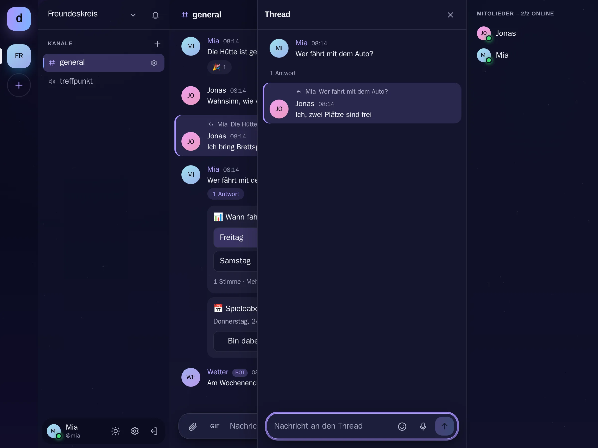

# Threads

[Alle Funktionen](README.md)

Antwort-Stränge zu einer Nachricht, neben dem Kanal.

## Ansicht

Hell: [threads-hell.webp](../../sites/hilfe/bilder/threads-hell.webp). Die Bilder macht `e2e/tests/hilfe-bilder.spec.ts`.

## Bedienung

- An der Nachricht auf Thread tippen, rechts öffnet sich die Leiste.
- „3 Antworten“ unter der Nachricht öffnet ihn wieder.

## Regeln und Grenzen

- Keine Threads in Threads. Antworten erscheinen nicht im Kanal und zählen nicht als ungelesen.
- Wer den Thread begonnen hat, bekommt eine Mitteilung wie bei einer Antwort.
- Wird die erste Nachricht gelöscht, wandern die Antworten in den Kanal.
- Nur Text.

## Technik

- `messages.thread_root_id`, `GET /api/messages/:id/thread`
- `threadRootId` beim Senden, Zähler `threadCount`
- `components/ThreadPanel.tsx`

## Tests

- `backend/test/chat-features.test.ts`
- `e2e/tests/chat-features.spec.ts`
